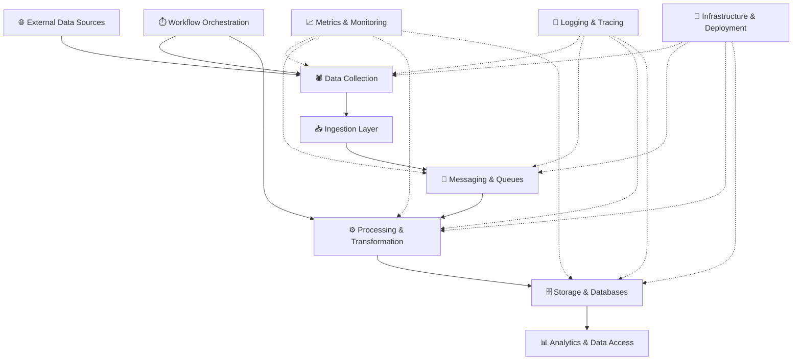

\<div align="center">

# ⚡ Open Data Engineering Ecosystem

### Building Better Data Systems, Together.

**An open-source ecosystem for data collection, processing, engineering, database optimization, distributed systems, and observability.**

Build reliable pipelines. Process data at scale. Monitor everything. Share knowledge.

[Overview](#-overview) · [Architecture](#-architecture) · [Technology Stack](#-technology-stack) · [Getting Started](#-getting-started) · [Roadmap](#-roadmap) · [Contributing](#-contributing)

\</div>

---

## 🌍 Overview

Modern applications and businesses depend on reliable data infrastructure. However, building scalable data pipelines, maintaining databases, collecting data, and monitoring distributed systems often requires significant engineering effort.

**Open Data Engineering Ecosystem** aims to simplify these challenges by bringing together reusable tools, practical implementations, architectural patterns, and production-oriented examples in one open-source repository.

The project covers the entire data lifecycle, from collecting raw data to transforming, storing, processing, and monitoring it.

Whether you're a backend developer, data engineer, infrastructure engineer, researcher, startup, or established business, this project aims to provide useful building blocks for creating better data-driven systems.

### 🎯 Our Mission

To make high-quality data engineering practices more accessible by sharing reusable solutions, documenting real-world engineering challenges, and encouraging collaboration across the developer community.

### 💡 What We Aim to Build

- **Data Collection:** Reusable crawling frameworks and data ingestion tools.
- **Data Processing:** Efficient transformation, validation, cleaning, and enrichment pipelines.
- **Data Engineering:** Batch processing, streaming, workflow orchestration, and pipeline design.
- **Database Engineering:** Database optimization, indexing strategies, migrations, and efficient data access.
- **Distributed Systems:** Reliable communication, asynchronous processing, and scalable task execution.
- **Observability:** Monitoring, metrics, logging, tracing, and operational dashboards.
- **Infrastructure:** Containerization, deployment automation, and reproducible environments.
- **Developer Resources:** Documentation, reference architectures, benchmarks, and practical examples.

---

## ✨ Core Principles

### 🧩 Modular by Design

Every component should be independently understandable, reusable, and easy to integrate into existing systems.

### ⚙️ Production-Oriented

Examples should demonstrate real engineering practices, including error handling, configuration management, logging, reliability, and operational visibility.

### 📈 Built for Scale

Explore architectures that support growing datasets, concurrent workloads, distributed processing, and increasing infrastructure demands.

### 📚 Documentation First

Provide clear explanations, setup instructions, architectural diagrams, examples, and practical guidance for developers of different experience levels.

### 🔍 Measurable Performance

Use reproducible benchmarks and meaningful metrics to evaluate performance, resource consumption, throughput, and reliability.

### 🤝 Open Collaboration

Encourage contributions, knowledge sharing, constructive discussions, and community-driven improvements.

---

## 🏗️ Architecture

The ecosystem is organized around the complete data lifecycle.



*Conceptual architecture: individual implementations may use different technologies depending on their requirements.*

### How It Works

1. **Collect:** Retrieve data from APIs, websites, databases, files, and other permitted sources.
2. **Ingest:** Validate incoming records and deliver them to the appropriate processing pipeline.
3. **Distribute:** Use messaging systems to decouple producers from consumers and distribute workloads.
4. **Process:** Clean, normalize, validate, enrich, and transform data.
5. **Store:** Persist data using storage technologies suited to the workload.
6. **Serve:** Make processed data available for applications, analytics, and downstream systems.
7. **Observe:** Monitor system health, throughput, latency, failures, and resource utilization.
8. **Orchestrate:** Schedule, coordinate, and recover workflows where appropriate.

---

## 🛠️ Technology Stack

The following technologies represent the project's intended toolkit. Individual modules can adopt the technologies that best fit their requirements.

| Domain                 | Technologies                           | Purpose                                                |
| ---------------------- | -------------------------------------- | ------------------------------------------------------ |
| Programming            | Python, SQL                            | Application logic, data manipulation, and queries      |
| Web Crawling           | Scrapy, HTTPX, Playwright              | Data collection and web automation                     |
| Data Processing        | Pandas, Polars, PyArrow                | Transformation, analysis, and columnar data processing |
| API Development        | FastAPI, Django, Django REST Framework | APIs and backend services                              |
| Relational Databases   | PostgreSQL, MySQL                      | Structured data storage and querying                   |
| NoSQL Databases        | MongoDB                                | Document-oriented storage                              |
| Caching                | Redis                                  | Caching, coordination, and temporary state             |
| Search                 | Elasticsearch                          | Search and text indexing                               |
| Messaging              | Apache Kafka, RabbitMQ                 | Event streaming and asynchronous communication         |
| Workflow Orchestration | Apache Airflow                         | Scheduling and coordinating data workflows             |
| Monitoring             | Prometheus, Grafana                    | Metrics collection, visualization, and alerting        |
| Logging                | Grafana Loki                           | Centralized log aggregation                            |
| Tracing                | OpenTelemetry                          | Instrumentation and distributed tracing                |
| Containers             | Docker, Docker Compose                 | Reproducible environments and local development        |
| Orchestration          | Kubernetes                             | Container orchestration and workload management        |
| Automation             | GitHub Actions                         | Continuous integration and delivery                    |
| Data Quality           | Pandera, Great Expectations            | Data validation and quality checks                     |

**Technology selection principle:** Prefer the simplest reliable solution that satisfies the requirements. Not every project needs every technology.

---

## 📦 Project Modules

The repository is intended to evolve into a collection of independently usable modules.

### 1. 🕷️ Data Collection & Crawling

Reusable components for gathering data from websites, APIs, and other permitted sources.

Potential features:

- Concurrent and asynchronous HTTP requests.
- Configurable crawling workflows.
- Pagination and incremental collection.
- Retry policies, timeouts, and rate limiting.
- Structured extraction and normalization.
- Proxy support where permitted.
- Data deduplication and validation.
- Checkpointing and resumable jobs.
- Collection metrics and structured logging.

**Goal:** Make data collection more reliable, maintainable, and easier to integrate into larger pipelines.

### 2. ⚙️ Data Processing & Transformation

Tools and examples for transforming raw data into clean, consistent, and useful datasets.

Potential features:

- Data cleaning and normalization.
- Schema validation.
- Missing-value handling.
- Deduplication and enrichment.
- Batch and streaming transformations.
- Memory-efficient processing.
- Incremental processing.
- Data quality checks.
- Processing performance benchmarks.

**Goal:** Reduce repetitive processing work while improving data quality and consistency.

### 3. 🔄 Data Engineering & Pipelines

Reference implementations for connecting collection, processing, messaging, and storage components.

Potential features:

- ETL and ELT pipeline examples.
- Batch and event-driven processing.
- Kafka producers and consumers.
- RabbitMQ task distribution.
- Workflow scheduling and orchestration.
- Idempotent processing.
- Dead-letter handling where appropriate.
- Retry strategies and failure recovery.
- Pipeline checkpoints and observability.

**Goal:** Provide reusable patterns for building reliable data workflows.

### 4. 🗄️ Database Engineering

Practical examples and utilities for designing, optimizing, and maintaining databases.

Potential features:

- Database schema design.
- Index selection and query optimization.
- Bulk inserts and upserts.
- Pagination strategies.
- Connection pooling.
- Database migrations.
- Transaction management.
- Query profiling and benchmarking.
- Relational and document database integration.
- Safe data migration patterns.

**Goal:** Help developers make informed database design decisions and improve data access efficiency.

### 5. 📨 Distributed Systems & Messaging

Examples for building loosely coupled applications and distributing work across services.

Potential features:

- Event-driven architecture.
- Message producers and consumers.
- Task queues and worker pools.
- Consumer groups and partitioning.
- Idempotent message processing.
- Backpressure and workload control.
- Retry and dead-letter strategies.
- Delivery guarantees and failure scenarios.

**Goal:** Demonstrate how to design distributed workloads that remain understandable and manageable as systems grow.

### 6. 📊 Monitoring & Observability

Reusable monitoring configurations and dashboards for understanding application and infrastructure behavior.

Potential features:

- Prometheus metrics.
- Grafana dashboards.
- Centralized logging with Loki.
- Distributed tracing with OpenTelemetry.
- Request latency and throughput measurements.
- Queue depth and consumer lag monitoring.
- Database connection and query metrics.
- Error rates and failure tracking.
- Resource utilization dashboards.
- Alerting examples and operational runbooks.

**Goal:** Make system behavior visible so developers can identify problems, investigate failures, and improve reliability.

### 7. 🐳 Infrastructure & Developer Experience

Tools and configurations for simplifying local development and deployment.

Potential features:

- Dockerfiles and Docker Compose environments.
- Environment-based configuration.
- Health checks and readiness checks.
- CI workflows and automated quality checks.
- Reproducible development environments.
- Example deployment manifests.
- Configuration templates.
- Setup scripts and troubleshooting guides.

**Goal:** Reduce the time between discovering a useful component and running it successfully.

---

## 🔬 Example End-to-End Workflow

Consider a system that collects public data, processes it, and makes it available to downstream applications.

```text
        Data Sources
             │
             ▼
      Collection Workers
             │
             ▼
       RabbitMQ / Kafka
             │
             ▼
     Processing Workers
             │
       ┌─────┴─────┐
       ▼           ▼
  PostgreSQL     MongoDB
       │           │
       └─────┬─────┘
             ▼
       Backend API
             │
             ▼
     Applications / BI

 Monitoring: Prometheus + Grafana
 Logging:    Loki
 Tracing:    OpenTelemetry
```

A complete example could demonstrate:

1. Collecting data from an approved source.
2. Publishing records to a message broker.
3. Processing and validating incoming records.
4. Persisting structured data in PostgreSQL.
5. Storing appropriate document-oriented data in MongoDB.
6. Exposing processed records through a FastAPI service.
7. Exporting operational metrics.
8. Visualizing throughput, errors, processing latency, and queue health.
9. Running the environment locally with Docker Compose.

Each implementation should document its architecture, assumptions, limitations, configuration, and performance characteristics.

---

## 📁 Proposed Repository Structure

```text
open-data-engineering/
│
├── docs/
│   ├── architecture/
│   ├── guides/
│   ├── best-practices/
│   └── troubleshooting/
│
├── examples/
│   ├── web-crawling/
│   ├── data-processing/
│   ├── etl-pipelines/
│   ├── database-optimization/
│   ├── event-driven-systems/
│   └── observability/
│
├── modules/
│   ├── data-collection/
│   ├── data-processing/
│   ├── database-tools/
│   ├── messaging/
│   └── observability/
│
├── infrastructure/
│   ├── docker/
│   ├── compose/
│   ├── prometheus/
│   ├── grafana/
│   └── kubernetes/
│
├── benchmarks/
│   ├── database/
│   ├── processing/
│   └── messaging/
│
├── scripts/
├── .github/
│   ├── workflows/
│   ├── ISSUE_TEMPLATE/
│   └── PULL_REQUEST_TEMPLATE.md
│
├── .env.example
├── .gitignore
├── CONTRIBUTING.md
├── CODE_OF_CONDUCT.md
├── LICENSE
├── SECURITY.md
└── README.md
```

*This is a proposed structure, not a claim that every directory or module already exists. The layout should evolve alongside the actual implementations.*

---

## 🚀 Getting Started

### Prerequisites

The exact requirements depend on the module you choose to run.

Common prerequisites include:

- Python 3.10 or a version supported by the selected module.
- Git.
- Docker and Docker Compose.
- Appropriate database or messaging services for the example.

### 1. Clone the Repository

```bash
git clone https://github.com/YOUR_USERNAME/open-data-engineering.git

cd open-data-engineering
```

Replace `YOUR_USERNAME` with the repository owner's GitHub username.

### 2. Create a Virtual Environment

```bash
python3 -m venv .venv
```

Activate it on Linux or macOS:

```bash
source .venv/bin/activate
```

Activate it on Windows PowerShell:

```powershell
.venv\Scripts\Activate.ps1
```

### 3. Install Dependencies

Install the dependencies documented for the specific module you want to use.

For a module that provides its own requirements file:

```bash
pip install -r modules/your-module/requirements.txt
```

*This command is illustrative; the file must exist in the selected module before the command can be used.*

### 4. Configure the Environment

Create a local environment file from the provided template:

```bash
cp .env.example .env
```

Configure the variables required by your selected example.

**Security:** Never commit real credentials, tokens, passwords, private endpoints, or production configuration to the repository.

### 5. Run an Example

Navigate to the selected example and follow its README.

Each runnable example should document its dependencies, configuration, startup commands, expected output, and cleanup procedure.

---

## 📈 Performance & Benchmarking

Performance matters, but benchmarks are only useful when they are reproducible and properly contextualized.

Where appropriate, the project will include benchmarks for:

- Database insertion and upsert throughput.
- SQL query latency and index effectiveness.
- Batch processing speed and memory consumption.
- Concurrent data collection throughput.
- Message broker throughput and consumer lag.
- End-to-end pipeline latency.
- Resource utilization under different workloads.

Every benchmark should document:

- Hardware and software versions.
- Dataset size and characteristics.
- Configuration and workload parameters.
- Measurement methodology.
- Results and relevant limitations.

**Our principle:** Publish measured results, not unsupported performance claims.

---

## 🔐 Security & Responsible Data Collection

Security and responsible engineering are fundamental to this project.

Contributors and users should:

- Respect applicable laws, source terms, and access restrictions.
- Follow API rate limits and use appropriate request concurrency.
- Avoid collecting sensitive personal data without a lawful basis.
- Never commit credentials or production secrets.
- Validate untrusted input.
- Use parameterized SQL queries.
- Apply least-privilege access to databases and infrastructure.
- Keep dependencies updated and review security advisories.
- Document security assumptions and operational risks.

Data collection examples should focus on authorized, permitted sources and responsible usage.

For security vulnerabilities, follow the reporting instructions in `SECURITY.md`.

---

## 🗺️ Roadmap

The project should grow incrementally, prioritizing useful and maintainable implementations over the number of technologies included.

### Phase 1 — Foundation

- [ ] Establish repository structure and contribution guidelines.
- [ ] Define coding standards and documentation conventions.
- [ ] Create reusable configuration and logging utilities.
- [ ] Establish automated code quality checks.
- [ ] Publish the first practical examples.

### Phase 2 — Data Engineering

- [ ] Add data collection examples.
- [ ] Add processing and validation utilities.
- [ ] Implement ETL and ELT reference workflows.
- [ ] Add PostgreSQL and MongoDB integration examples.
- [ ] Document indexing, bulk writes, and query optimization.

### Phase 3 — Distributed Systems

- [ ] Add Kafka producer and consumer examples.
- [ ] Add RabbitMQ task processing examples.
- [ ] Demonstrate retry and failure recovery strategies.
- [ ] Document idempotency and workload management.

### Phase 4 — Observability

- [ ] Add Prometheus instrumentation.
- [ ] Publish Grafana dashboard examples.
- [ ] Add centralized logging examples.
- [ ] Demonstrate distributed tracing.
- [ ] Document monitoring and alerting practices.

### Phase 5 — Production Readiness

- [ ] Add Docker Compose environments.
- [ ] Publish reproducible performance benchmarks.
- [ ] Improve deployment documentation.
- [ ] Add security and dependency checks.
- [ ] Collect community feedback and prioritize improvements.

*Roadmap items describe intended work and should be updated as features are implemented.*

---

## 🤝 Contributing

Open-source collaboration is central to the project's vision.

Contributions can include:

- New modules and practical examples.
- Bug fixes and performance improvements.
- Database optimization techniques.
- Monitoring dashboards and configurations.
- Documentation and architecture diagrams.
- Reproducible benchmarks.
- Security improvements and troubleshooting guides.

### Contribution Workflow

1. Open an issue to discuss substantial changes.
2. Fork the repository.
3. Create a focused feature branch.
4. Implement the change with appropriate documentation.
5. Run the available quality checks.
6. Submit a pull request explaining the change and its impact.

Keep contributions modular, maintainable, and focused on a clear problem.

See `CONTRIBUTING.md` for the complete contribution guidelines.

---

## 🌱 Who Is This Project For?

### Backend Developers

Explore reusable components for APIs, databases, background jobs, and distributed services.

### Data Engineers

Discover patterns for ingestion, transformation, orchestration, storage, and streaming pipelines.

### Database Engineers

Learn from practical indexing, query optimization, bulk operations, and migration examples.

### DevOps & Platform Engineers

Explore containerized environments, metrics, logging, tracing, and infrastructure automation.

### Startups & Businesses

Use documented reference implementations to evaluate architectural options and reduce repetitive engineering work.

### Students & Open-Source Contributors

Learn by exploring practical examples and contribute improvements that benefit the wider community.

---

## 🌟 Long-Term Vision

The long-term goal is to establish a trusted, community-driven resource for practical data engineering.

Instead of forcing developers to search across disconnected tutorials and isolated code snippets, the project aims to provide a coherent collection of reusable components, documented architectures, real-world examples, and measurable engineering practices.

Success will be measured by the usefulness of its implementations, the quality of its documentation, the reliability of its examples, and the value it delivers to the developer community.

**Build useful tools. Share engineering knowledge. Make better data systems accessible to everyone.**

---

## 📜 License

This project should use an open-source license selected by its maintainers.

Before publishing, add the appropriate `LICENSE` file and update this section to identify the chosen license and any applicable third-party licensing requirements.

---

\<div align="center">

### ⚡ Built for Developers. Designed for Real-World Data Systems.

**Collect · Process · Store · Observe · Improve**

If you find this project useful, consider starring the repository, reporting issues, sharing ideas, or contributing improvements.

\</div>
